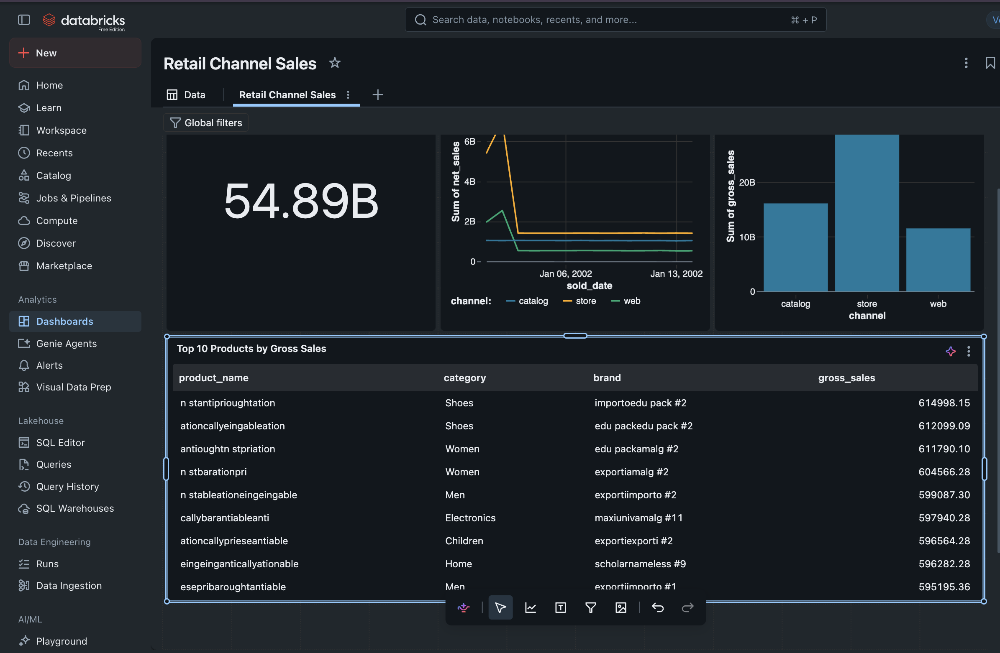
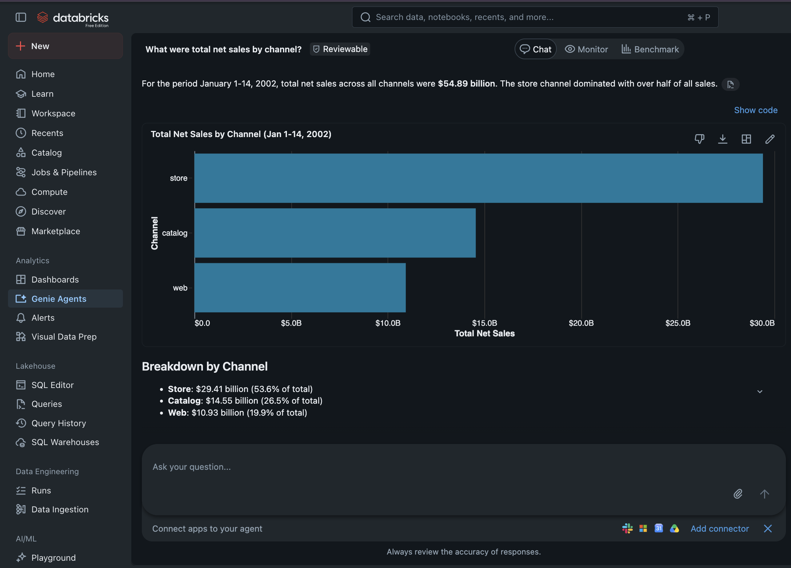

# Retail Channel Sales Intelligence System

A personal project I built on Databricks (Free Edition) using the TPC-DS sample
data in `samples.tpcds_sf1000`. Everything here runs on a two week slice of the
data, 1 to 14 January 2002, because the full sales data is about 5 billion rows
and a free workspace is not the place to copy all of it. The notebooks are in
`/Workspace/Demo_Project/` in my workspace.

Built with: Databricks (Serverless SQL warehouse), Delta Lake, Spark SQL,
Unity Catalog, Databricks Jobs, AI/BI Dashboards, and Databricks Genie.

## Why I built it

In the source data, sales sit in three separate channel tables: store, web, and
catalog. Nothing lines them up, so a simple question like "what did we sell
yesterday" has three different answers depending on where you look. I wanted
one set of numbers that a dashboard and an AI agent could both use, where I
could trace any figure back to the source rows and prove it.

## How it fits together

The TPC-DS tables feed a Silver layer that unions the three channels into one
sales table and one returns table. On top of that sit Gold tables with daily
aggregates. The dashboard and the Genie agent read only Gold. A Databricks Job
rebuilds everything from source and runs quality checks at the end. If the
checks fail, the run fails.

## Tables (workspace.retail)

- Silver: `silver_store_sales`, `silver_all_sales` (28,199,362 rows for the slice), `silver_all_returns`
- Gold: `gold_daily_channel_sales`, `gold_daily_net_sales`, `gold_daily_returns`, `gold_top_products`

## Definitions I had to get straight

These mattered more than the code. Get one of them wrong and every number
after it is wrong too.

- Gross sales is the extended price of what was sold, before returns, without
  taxes and fees.
- Net sales is gross minus returns.
- Returns are counted on the day the return happened, not the day of the
  original sale. Mixing those two up changes every daily number.
- An order is a distinct ticket. One row in the source is one item on a
  ticket, and there are about 12 items per ticket, so counting rows as orders
  overstates orders by roughly 12 times.
- About 4.5% of store sales rows have no sale date at all. They are real
  sales, but they cannot go in any date based report, so these tables leave
  them out.
- For web and catalog, the customer is the billing customer and the location
  is the warehouse. The source offers a few choices here; this is the one I
  picked, and it is written down so the agent uses the same one.

## What the numbers came out as (1 to 14 Jan 2002)

- Gross sales: 60,023,366,486.73 | Returns: 5,130,624,872.13 | Net sales: 54,892,741,614.60
- Net by channel: store 29,407,210,700.90 | catalog 14,553,183,186.55 | web 10,932,347,727.15
- Return rate by channel: catalog 9.8% | store 9.1% | web 5.3%
- Total orders: 2,598,807 | Best day: 2002-01-02 (10,595,422,126.45 net)

Silver ties back to the source exactly, and Gold ties to Silver. Net equals
gross minus returns to the cent. I checked all of that in SQL before anything
else was built on top.

## How to run it

1. You need a Databricks workspace. The Free Edition is enough, and it already
   has the TPC-DS data under `samples.tpcds_sf1000`, so there is nothing to
   download or load.
2. Create the schema the tables live in: `CREATE SCHEMA IF NOT EXISTS workspace.retail;`
   If you use a different catalog or schema name, change it in the notebook
   code too, because the builds write to `workspace.retail`.
3. Import the build files from the `sql/` folder of this repo into a folder in
   your workspace: `02_silver_build.sql`, `03_gold_build.sql`,
   `04_returns_build.sql`, `05_quality_checks.sql`. They import as notebooks.
4. Run them in order, 02 then 03 then 04 then 05, on the Serverless Starter
   Warehouse. The last one is the quality gate: it should show all 4 checks
   PASS.
5. To run it the way I do, create a Job with the four notebooks as tasks in
   the same order and run the Job instead. That is the `retail_sales_pipeline`
   Job described below.
6. The dashboard and the agent sit on top of the Gold tables. For the agent,
   create a Genie space over the four Gold tables and paste in the
   instructions from `genie/instructions.md` and the examples from
   `genie/example_queries.sql`. The questions in
   `genie/benchmark_questions.md` and the SQL in `sql/06_evaluation.sql` are
   how I checked its answers.

## Pipeline

The Job is called `retail_sales_pipeline` (ID 75761342656027), all Serverless.
It runs `02_silver_build`, then `03_gold_build`, then `04_returns_build`, then
`05_quality_checks`.

Every build is CREATE OR REPLACE straight from source, so there is no
incremental state to corrupt, and re-running the Job fixes bad data by
rebuilding it. I tested that on purpose. I rebuilt Silver without the web
channel, two of the four quality checks failed and the gate stopped the run,
and then a Job re-run put everything back to 4 PASS.

## Dashboard

The dashboard is called Retail Channel Sales, and it is published. It reads
Gold tables only: a total net sales counter, gross sales by channel, a daily
net trend, and a top 10 products table. I checked every widget against SQL by
hand, and two of them needed it: the trend chart first grouped the 14 days by
month, which hid the whole pattern, and the top products query failed on a
trailing semicolon in the dashboard editor.

## Genie agent

The agent is called Retail Gold Sales and Returns Performance Summary (Agent
ID 01f1e23a46481afa913829f8d5f969). It can only see the four Gold tables. Its
instructions carry the definitions above, limit it to 1 to 14 January 2002,
and tell it to use net sales when someone just asks for "sales", and to say
that it did. It also has four example queries to learn the shape of a good
answer from.

## How I checked the agent

I wrote 10 questions and worked out every expected answer in SQL by hand
first (notebook `06_evaluation`), then ran them in the agent's Benchmark tab.
The result was 10 out of 10 correct, after I reviewed the flagged ones
myself. The automated judge flagged two answers. Both times the values were
exact and the judge was objecting to which Gold table the agent had read
from, so I marked them good and wrote down why.

There were also two trap tests. Asked about March 2002, the agent refused and
said the data only covers January 1 to 14. Asked "What were sales?", it
answered with net sales and said so.

## What I would do next

- The slice is 14 days because of the free workspace. A real version would
  load the full history once and then update it incrementally.
- The 2003 data in the source is partial, so I would not report on it as a
  full year.
- Two small jobs are still open: putting the Job on a schedule, and adding
  Unity Catalog comments on the Gold tables.
