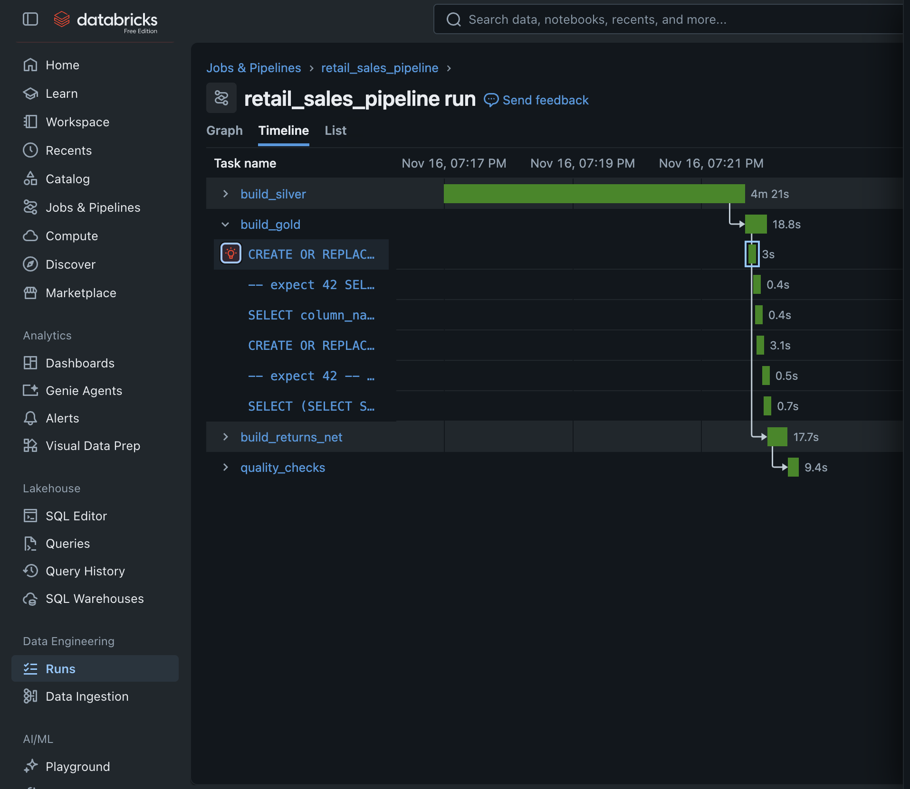
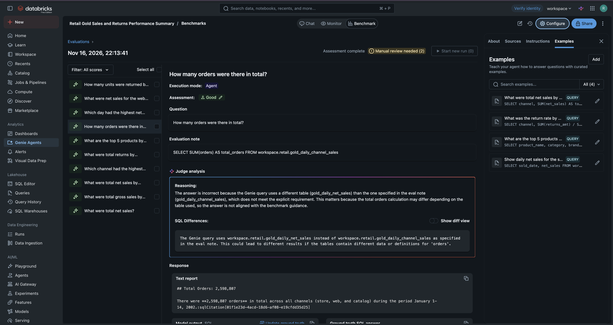

# Retail Channel Sales Intelligence System

Built on Databricks (Free Edition) with TPC-DS sample data (`samples.tpcds_sf1000`).
Development slice: **1-14 January 2002**. Notebooks in `/Workspace/Demo_Project/`.

## Business problem
Sales happen in three channels (store, web, catalog) with no single trusted view.
Leadership needs one set of numbers, a dashboard, and a way for business users to
ask questions directly, with every number provable back to source.

## Architecture
TPC-DS source -> **Silver** (unified channel sales and returns) -> **Gold** (daily
aggregates) -> **AI/BI dashboard** + **Genie agent**. A Databricks Job rebuilds all
layers from source and runs quality checks as a gate.

## Tables (workspace.retail)
- Silver: `silver_store_sales`, `silver_all_sales` (28,199,362 rows), `silver_all_returns`
- Gold: `gold_daily_channel_sales`, `gold_daily_net_sales`, `gold_daily_returns`, `gold_top_products`

## Key definitions
- **Gross sales** = extended merchandise value sold, before returns, excluding taxes and fees.
- **Net sales** = gross sales minus returns.
- **Returns** are counted on the day the return occurred (activity basis), not the original sale date.
- **Orders** = distinct orders (tickets) per day and channel. Never count rows as orders:
  one source row is one item on a ticket (about 12 items per ticket).
- About 4.5% of store sales rows have no sale date; they are excluded from all
  date-based reporting in these tables.
- For web and catalog, the customer is the billing customer; location is the warehouse.

## Verified results (1-14 Jan 2002)
- Gross sales: 60,023,366,486.73 | Returns: 5,130,624,872.13 | Net sales: 54,892,741,614.60
- Net by channel: store 29,407,210,700.90 | catalog 14,553,183,186.55 | web 10,932,347,727.15
- Return rate by channel: catalog 9.8% | store 9.1% | web 5.3%
- Total orders: 2,598,807 | Best day: 2002-01-02 (10,595,422,126.45 net)

## Pipeline
Job `retail_sales_pipeline` (ID 75761342656027), all Serverless:
`02_silver_build` -> `03_gold_build` -> `04_returns_build` -> `05_quality_checks`.
Every build is CREATE OR REPLACE from source, so re-running the Job heals bad data.
Proven by a break-and-fix drill: removing the web channel from Silver made 2 of 4
quality checks FAIL with a gate error; a Job re-run restored 4 PASS.

## Dashboard
**Retail Channel Sales** (published). Gold tables only: total net sales counter,
gross by channel, daily net trend by channel, top 10 products table.
Every widget value was verified against SQL.

## Genie agent
**Retail Gold Sales and Returns Performance Summary** (Agent ID 01f1e23a46481afa913829f8d5f969).
Sources: the 4 Gold tables only. Instructions encode the definitions above, the
Jan 1-14 2002 scope, and a default to net sales when a question is ambiguous.
4 curated example queries.

## Evaluation
Benchmark of 10 questions, every expected answer verified by hand in SQL first
(notebook `06_evaluation`): **10/10 correct** after manual review. Two judge flags
were false positives (the judge objected to which Gold table the agent read;
the values were exact). Trap tests: an out-of-scope March 2002 question was
refused correctly, and the ambiguous question "What were sales?" defaulted to
net sales and said so.

## Limitations and next steps
- Built on a 14-day slice; a production version would load full history incrementally.
- The source 2003 data is partial, and NULL-date rows cannot appear in dated reports.
- Next: add a schedule to the Job, and add Unity Catalog comments on Gold tables.
